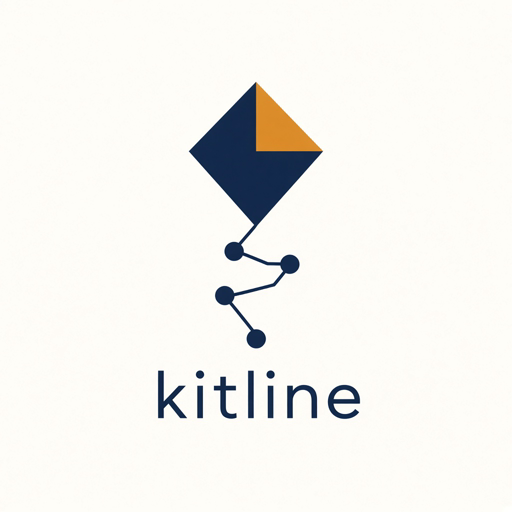

#+title: kitline
#+options: toc:nil num:nil ^:{}

Triage, stamp, and track are the commands a bot runs. See QUICKSTART.org.

One command installs a prebuilt kitline: curl -fsSL https://github.com/leidarljos/kitline/releases/latest/download/install.sh | sh.
The script checks SHA256SUMS, then copies the binary to $HOME/.local/bin.
Set KITLINE_INSTALL_DIR to choose a different directory.

kitline reads one TOML (Tom's Obvious Minimal Language) workspace.
It writes an org report and a POSIX sh script.
The script lists the commands for nodes that are ready to merge.
kitline does not push, tag, publish, comment, or merge.
=open_pr= is off unless a node sets it.

* Run

#+begin_src sh
kitline --workspace workspace.toml --report plan.org --script plan.sh
#+end_src

Run kitline again after a node merges into its base.
A missing bundle prerequisite exits 1.
An ambiguous pin exits 2.
A schema mismatch exits 2.
Two claims of one value exit 2.
A dropped private edge exits 2.
A cycle exits 3.

* Example

=tests/fixtures/example/init.sh= builds a local clone and a bundle.
=tests/fixtures/example/workspace.toml= is the workspace.

#+begin_src sh
sh tests/fixtures/example/init.sh
kitline --workspace tests/fixtures/example/workspace.toml --report plan.org --script plan.sh
#+end_src

* Workspace

A node has an id, a repo path, a base, and a branch.
A tag check sits ahead of a pin bump.
A registry publish check sits ahead of a pin bump.
Pins come from =build.zig.zon=, Cargo manifests, meson wrap files, and the Cargo metadata keys the workspace lists.
A run file marks nodes that have already merged.
=--tickets= is optional.
=--online= is the only switch that may call =git ls-remote=.
